<div align="center">


# Aria Lyric Player

[简体中文](README.md) | **English**

[](https://github.com/zsjsll114/Aria/releases/latest)
[](https://github.com/zsjsll114/Aria/releases/latest)
[](LICENSE)
[](https://github.com/zsjsll114/Aria/actions/workflows/ci.yml)

**A multi-source online music player: QQ / KuGou / Netease / Kuwo search, 14 lyric visual modes, Visual Workshop, desktop lyrics overlay, phone remote, and AI mood analysis**

Web app + Tauri 2 desktop shell — a player built for long, immersive listening sessions.

[14 Lyric Visuals](#14-lyric-visuals) ·
[What's New in v3.0](#whats-new-in-v30) ·
[Core Features](#core-features) ·
[Quick Start](#quick-start) ·
[FAQ](#faq) ·
[Architecture](#architecture) ·
[License](#license)

</div>

---

For personal use only. This repository contains no audio, lyrics, or cover art; online music-source APIs are provided at runtime by third-party open-source projects running locally — see the [Disclaimer](#third-party-sources-and-disclaimer) at the bottom.

## 14 Lyric Visuals

Fourteen modes organized into four visual families (Classic Lyrics / Spatial & Particles / Kinetic & MV / Editorial & Craft), switchable from the style picker or customized live in **Settings → Visual Modes**:

| Family | Mode | Description |
|---|---|---|
| Classic Lyrics | Default | Cover art and lyrics side by side, frosted-glass controls, automatic dual-page mobile layout |
| Classic Lyrics | Lyrics | Full-screen word-sync lyrics with coupled spring-wave scrolling, frosted bottom bar, and trilingual (original / translation / romaji) display |
| Classic Lyrics | Fly-In | Hero poster-scale word-by-word entrance, emotion-word highlights, and song-seeded geometric background field |
| Spatial & Particles | WordCloud | Golden-angle constellation spiral with orbital rings, curved starlight threads, 4-tier optical depth-of-field bokeh, and pure GPU camera tracking |
| Spatial & Particles | Mondrian | De Stijl color-block collage: blocks split by line meaning across 8 geometric compositions with collision-aware word placement |
| Spatial & Particles | Dimension | 3D particle fluid mist and floating dot-matrix cubes with mood-reactive depth and parallax |
| Spatial & Particles | Prism | Multi-camera optical crystal facets: 36 geometric refraction layouts, cross-facet inverted typography, and chromatic dispersion |
| Kinetic & MV | Verse | Multi-shot lyric film: giant close-ups, magazine spreads, collage fragments, per-word dispersion, and timeline-driven camera choreography |
| Kinetic & MV | Folio | Swiss editorial celestial posters: 54 break-frame arcs and Bauhaus solid planes, 8 typographic topologies, and positive/negative inversion |
| Kinetic & MV | FocalCut | 2.5D architectural exhibition-wall studio: darkroom & gallery-paper dual polarities, split-lens cuts, and dual-layer `clip-path` optical word sweeps |
| Editorial & Craft | Letterpress | Adaptive lead-type glyph matrix (responsive to window resizing) + cotton-paper inking + vermilion seal with mood-driven paper palettes |
| Editorial & Craft | Jizura | Japanese text-PV engine ([JIZURA](https://github.com/852wa/JIZURA) port, MIT): 27 layouts × 860 parts auto-storyboard synchronized to lyrics |
| Editorial & Craft | Vitrail | Native WebGL2 3D optical cathedral: 8 architectural sanctuary prototypes touring by song chapter, double-buffered transitions, and carved word glow |
| Editorial & Craft | Tempera | Halftone-print lyric PV: color-block cut-out windows, dynamic lyric inversion, and 121 camera variants |

<table>
  <tr>
    <td align="center" width="33%">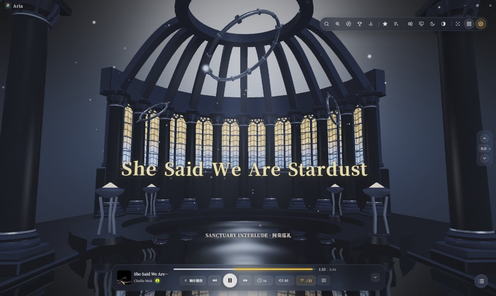<br><sub><b>Vitrail</b></sub></td>
    <td align="center" width="33%">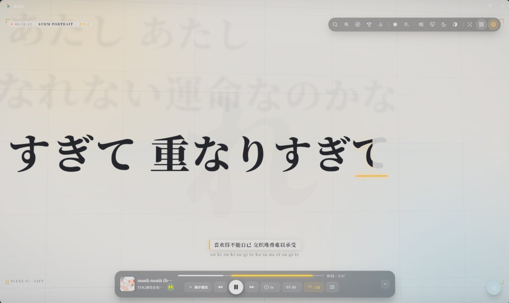<br><sub><b>FocalCut</b></sub></td>
    <td align="center" width="33%">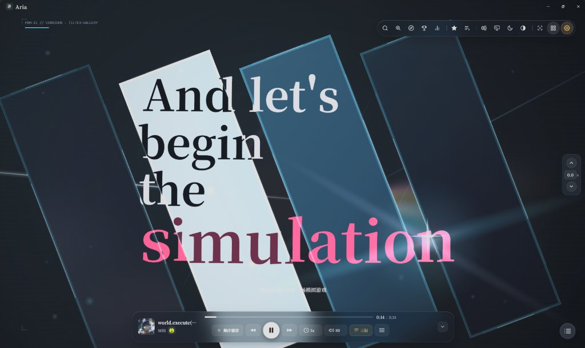<br><sub><b>Prism</b></sub></td>
  </tr>
  <tr>
    <td align="center">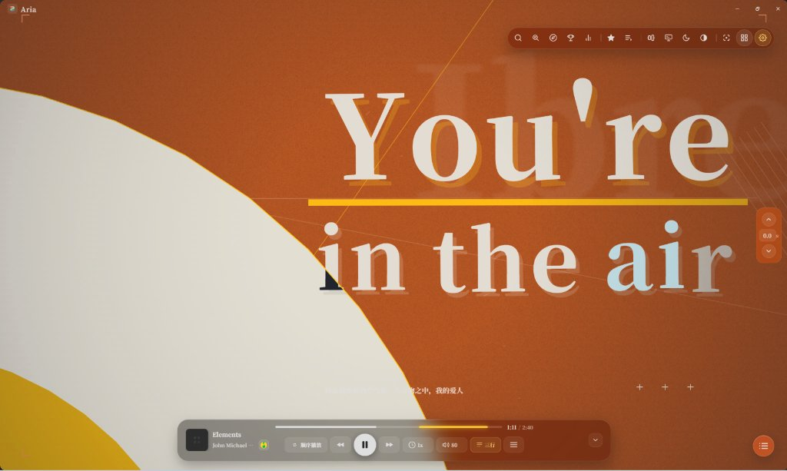<br><sub><b>Folio</b></sub></td>
    <td align="center">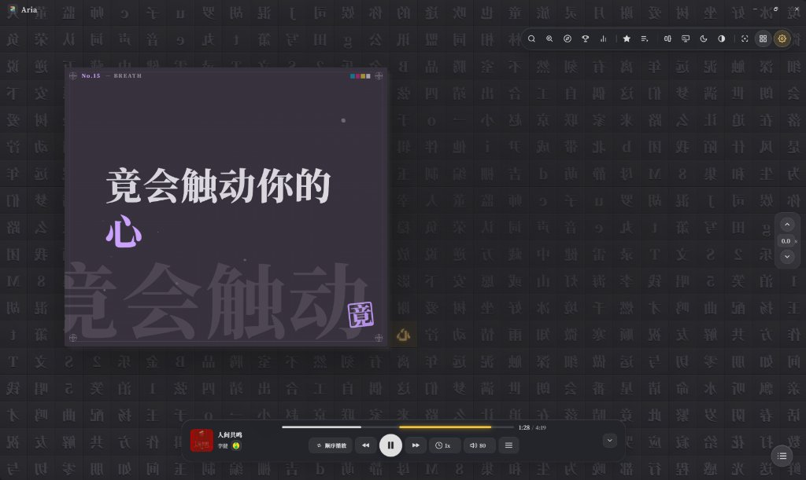<br><sub><b>Letterpress</b></sub></td>
    <td align="center">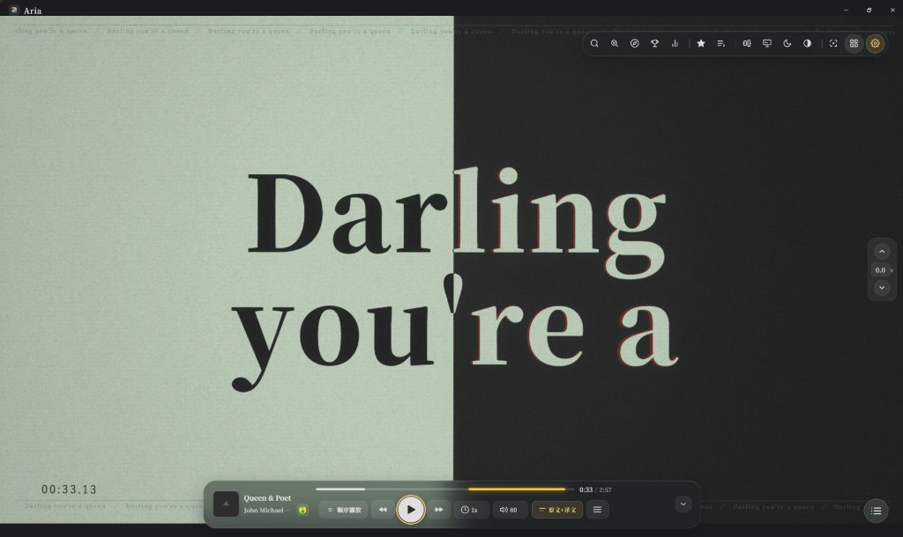<br><sub><b>Jizura</b></sub></td>
  </tr>
  <tr>
    <td align="center">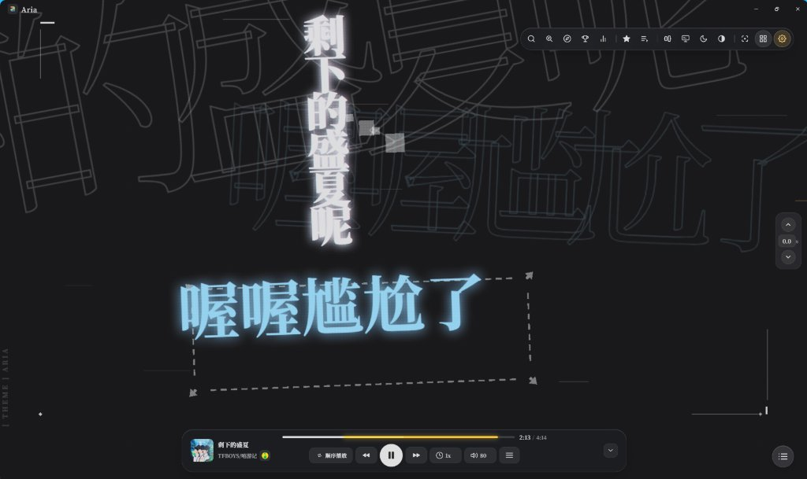<br><sub><b>Verse</b></sub></td>
    <td align="center">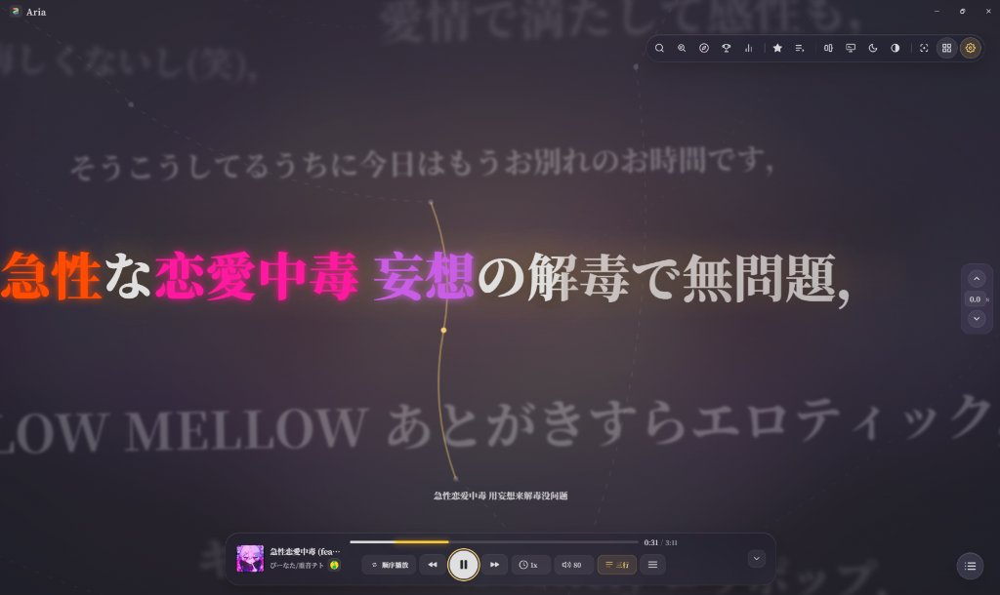<br><sub><b>WordCloud</b></sub></td>
    <td align="center">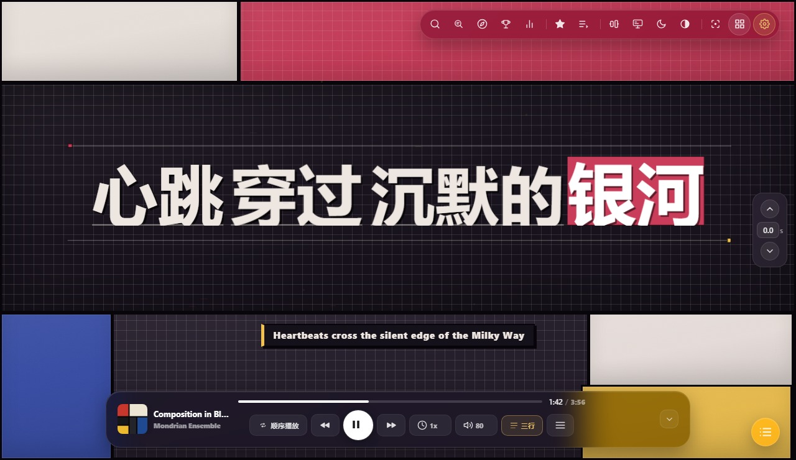<br><sub><b>Mondrian</b></sub></td>
  </tr>
  <tr>
    <td align="center">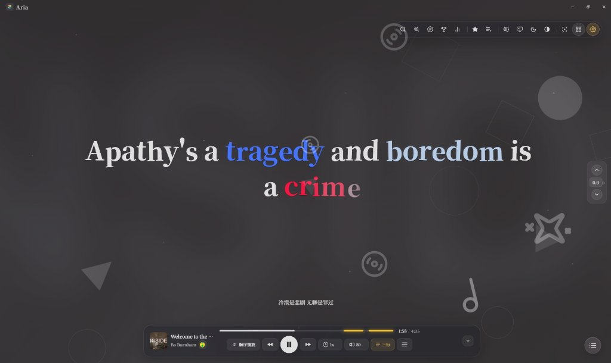<br><sub><b>Fly-In</b></sub></td>
    <td align="center">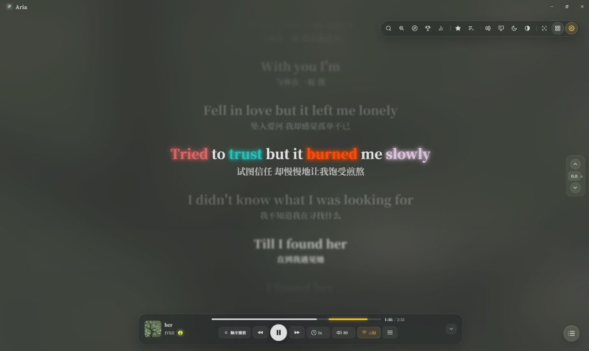<br><sub><b>Lyrics</b></sub></td>
    <td align="center">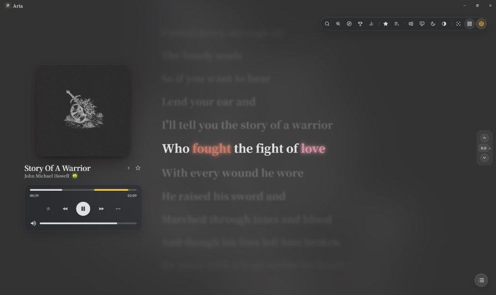<br><sub><b>Default</b></sub></td>
  </tr>
</table>

AI mood analysis improves the result: per-line emotion tags and chorus detection drive mood-aware palettes and compositions. All modes also work without it, falling back to purely timeline-driven behavior.

RTL lyrics (Arabic / Hebrew etc.) light up right-to-left automatically in every visual mode, no configuration needed.

## What's New in v3.0

- **Four New Flagship Visual Modes**: Native WebGL2 3D cathedral **Vitrail**, optical crystal-refraction **Prism**, Swiss editorial **Folio**, and redesigned 2.5D exhibition-wall **FocalCut**; plus refactored constellation **WordCloud** and redesigned mode preview cards across all visual styles.
- **Visual Workshop & Unified Frosted Glass**: Declarative Settings & Visual Workshop (4 families × 14 modes popover grid + 3-tier controls + live preview); eliminated nested Chromium Backdrop Roots so top bars, bottom bars, workshop popovers, and dropdown menus render true translucent Gaussian blur with automatic degradation on low-end / software GPUs.
- **Frame-Pacing & Background Resume Overhaul**: Eliminated 60fps `:root` CSS variable full-DOM recalc, paused hidden 150% fullscreen blur layers behind opaque visualizers, removed out-of-phase `timeupdate` double-updates, moved desktop lyrics to non-blocking `BroadcastChannel`, and hardened foreground recovery (including Fly-In font scaling and responsive Letterpress matrix reflow).
- **Listening Experience Upgrades**: Mode-aware lyric posters, listening stats reports, self-hosted API parameter customization (QQ / KuGou / Netease), non-destructive Focus/Zen bar collapse, and comprehensive Chinese / English i18n coverage.

## Core Features

| Module | Description |
|---|---|
| Word-by-word lyrics | YRC / KRC / QRC full-format word timelines, original / translation / romaji three-line layout; automatic alignment fallback when word timing is missing |
| Multi-source search | QQ Music / KuGou / Netease / Kuwo with local self-hosted priority and multi-tier public fallback; self-hosted services provide hi-fi audio, daily mixes, cloud playlists, and API parameter controls |
| AI mood analysis | Gemini or OpenAI-compatible APIs: per-line emotion tagging + chorus detection, driving layout & palette changes in visual modes |
| Desktop lyrics | Standalone transparent window, free drag, click-through, non-blocking `BroadcastChannel` sync, and local per-word interpolation |
| Phone remote | Scan or type the address on your phone (same LAN) to control playback / track / volume (requires `--lan`) |
| Local music | Local library scan + Enhanced LRC word-timeline generation + song recognition (Shazam / Vosk) |
| Playlists & stats | Favorites / playlists / public playlist import from Netease, QQ & KuGou / artist pages / listening reports |
| Audio | 10-band equalizer (with AutoEQ PEQ import), spatial audio / virtual soundstage, native WASAPI output, speed control (pitch preserved), long-press 2× fast-forward, A-B loop, seamless crossfade, sleep timer |
| Experience details | Mode-matched lyric posters, in-lyrics search, bilingual toggle, next-song preview, OSD hints, zen / focus mode, VFX recipes, theme palette, VFX intensity slider, toolbar customization |

## Quick Start

### Portable build (regular users)

Grab `Aria-Portable.zip` from [Releases](../../releases), extract to a path with **ASCII characters only**, then:

- `Aria.exe` — desktop window version (recommended)
- `StartAria.bat` — browser web version

No Python / Node installation needed; all dependencies are bundled.

### Running from source

Prerequisites: Python 3.10+ (backend uses stdlib only), Node.js 20.19+ or 22.13+ (22 LTS recommended), Git. The desktop shell needs the Rust toolchain.
The Node floor comes from two dependencies: the QQ music-source mirror requires `^20.17.0 || >=22.9.0`, and this repo's ESLint 10 requires `^20.19.0 || ^22.13.0 || >=24`.

```bat
:: 1. Fetch music-source services into _eval\ (not committed; required once after a fresh clone)
scripts\setup-vendors.bat

:: 2. Start the local server (listens on localhost only by default)
python server.py

:: 3a. Web: open http://localhost:8001 in your browser
:: 3b. Desktop: double-click restart-aria.bat (restart + incremental cargo build, first run compiles)
```

macOS / Linux have no .bat files — run the equivalent commands manually.

## Before You Start

1. **Mainland users behind a Cloudflare Worker proxy: the page URL must be `http://localhost:8001`**, not `127.0.0.1` — the Worker validates the page Origin and returns `403 Forbidden` otherwise. Calling the API directly (no Worker) has no such restriction.
2. **The server listens on localhost only by default.** To use it from your phone (including the phone remote), run `python server.py --lan`. This exposes search, proxy and config APIs (including AI keys) to your LAN — home WiFi only, turn it off afterwards.
3. **Self-hosted music-source services need separate logins.** Without login it automatically falls back to the free source pool: search and playback still work, but no hi-fi, daily mixes or playlist sync. Login and upstream parameter settings live in **Settings → Self-Hosted**.

## Feature Guide

### Desktop Lyrics

Toggle via the "Desktop Lyrics" button at the top right. Drag the lyric bar to move it, ✕ to close, the lock button toggles click-through. Position is saved automatically after dragging. Font size, color, stroke and fonts are in **Settings → Lyrics**.

### Phone Remote

Start with `python server.py --lan`, then open `http://<your-LAN-IP>:8001/remote.html` in your phone browser (the server prints the usable address on startup). Play / pause / skip / volume work remotely, with live lyric progress sync.

### Fonts

- Pick the global font in **Settings → Fonts**; each visual mode can override it under **Settings → Visual Modes → Per-Mode Background & Font Override**.
- **Drop files into the font folder**: put `.ttf / .otf / .woff / .woff2` files into `web/src/font/`, refresh, and they appear in every font dropdown.
- The font manager auto-categorizes into Serif / Hei / Kai / Pixel / Monospace with collapsible groups.
- Recommended fonts (large glyph coverage, free for commercial use): Noto Sans SC, Noto Serif SC, MiSans, HarmonyOS Sans, LXGW WenKai.
- **Prefer static-weight versions**: variable fonts (VF, often `-VF` in the filename) are expensive to render at full-screen sizes and may cause frame drops on low-end devices.

### Playlists & Favorites

Favorites: the heart button at the end of any row. Playlists: create / rename / delete on the "Playlists" page, with import from public Netease / QQ / KuGou playlist links and synced cloud playlists / Liked Songs after signing in.

### AI Mood Analysis

Fill in an API key under **Settings → AI Analysis** (Gemini official and OpenAI-compatible endpoints both supported). For mainland networks a Cloudflare Worker proxy is recommended (`docs/cf-gemini-auth-worker.js` has a ready-made script); direct API URLs work too. Keys are stored only in your local `user_config.json` and never uploaded.

## Known Limitations

- Multi-monitor / mixed-DPI setups are not fully tested; external screens may show cursor or positioning offsets.
- WebGL2 3D visual modes (e.g. Vitrail) automatically disable frosted glass and heavy post-processing on software GPUs; performance tiers can also be tuned manually in **Settings → Performance**.
- Variable fonts (VF) as the global font are expensive to interpolate at full-screen sizes — low-end devices should use static-weight fonts (e.g. Noto Sans SC Bold) or lower the performance tier.
- Embedded lyrics (USLT / multi-track AWLRC) may pick the wrong track on some files.

## About How This Is Built

Product shape, architecture decisions and code review are the author's work; implementation, tests and documentation are produced with AI assistance. When filing issues, just describe the problem — there is no need to distinguish who wrote what.

## FAQ

- **Blank page / can't connect**: make sure the server window is still open and port 8001 isn't taken; on desktop check `server_debug.log`.
- **Search returns nothing**: try another source; if all fail it's most likely a temporary third-party API outage — retry later.
- **Hi-fi options are greyed out**: login to that platform's self-hosted service is required.
- **AI always returns 403**: your page URL isn't `localhost` — see note 1 above.
- **Desktop lyrics in the wrong place after restart**: wait a moment after dragging before closing; if it still misbehaves, lock → unlock once.
- **Phone remote won't connect**: make sure the server was started with `--lan` and your phone is on the same WiFi.

Please report issues with the [ISSUE template](.github/ISSUE_TEMPLATE/bug_report.md) — attaching console errors and system info speeds things up a lot.

## Architecture

```
Tauri 2 shell (Rust) ── loads http://localhost:8001, launches backend & native audio engine
        │
Python backend (stdlib-only http.server, port 8001)
  ├ serves web/ statically + /proxy + /api/* (incl. /api/remote/* phone-remote bus)
  └ selfhost_service.py: three Node music-source services (3100/3200/3201, loopback-only)
```

The frontend is a framework-free sharded module system (`web/src/app/*.js`, loaded by number), with declarative settings & Visual Workshop in `web/src/config/` and `web/src/ui/`, and visual engines in `web/src/core/` (pvEngine / tunnelEngine / visualizers). See [AGENTS.md](AGENTS.md) and [CODE_WIKI.md](CODE_WIKI.md) for details.

## Third-Party Sources and Disclaimer

The `_eval/` directory holds local mirrors of third-party music-source API projects (KuGouMusicApi / NeteaseCloudMusicApi / qq-music-api-node), cloned and installed by `scripts/setup-vendors.bat`. They are **not part of this repository**, follow their original licenses, and are maintained independently upstream. This project merely calls them on 127.0.0.1 and does not modify their upstream logic (`patches/` contains local fixes for the QQ mirror, used by this project only).

On top of that:

1. This repository contains and distributes no audio, lyrics, or cover art. Media content either comes from files already on your machine or is returned at runtime by the third-party APIs above.
2. Third-party APIs may change or break at any time; no availability is guaranteed.
3. This project is a personal-learning, personal-use player frontend. Please check the terms of service and copyright rules that apply in your region, and support official releases where you can. Do not use this project or its packaged builds for commercial distribution.

## Acknowledgements

- [folia-major](https://github.com/chthollyphile/folia-major) (AGPL-3.0) — **source of the code for the "Verse" (`sonnet/`) and "Tempera" (`tempera/`) visual engines** (faithful line-by-line port); see [THIRD_PARTY_NOTICES.md](THIRD_PARTY_NOTICES.md) for the full file list
- [JPV Lyrics Motion Kit](https://github.com/donbeeshyvt-jpg/jpv-lyrics-motion-kit) (AGPL-3.0) — source of the tunnel mode's per-word entrance themes, the PV background shape field and the Cadenza per-word light sweep (adapted)
- [JIZURA](https://github.com/852wa/JIZURA) (MIT) — inspiration & architecture for the "Jizura" Japanese text-PV engine
- [KuGouMusicApi](https://github.com/makbkf/KuGouMusicApi) / [NeteaseCloudMusicApi](https://github.com/Binaryify/NeteaseCloudMusicApi) / [qq-music-api-node](https://github.com/jsososo/QQMusicApi) — music-source APIs
- [Tauri](https://tauri.app/) · [segmentit](https://github.com/nekobato/segmentit) · [kuromoji.js](https://github.com/takuyaa/kuromoji.js)
- Fonts: Noto Sans SC / Noto Serif SC (Noto CJK, SIL OFL) · LXGW family · Fangzheng Pixel · Cubic 11

## License

[AGPL-3.0](LICENSE). The project as a whole is released under the GNU Affero General Public License v3.0.

**Why AGPL**: the "Verse" (`web/src/core/visualizers/sonnet/`) and "Tempera" (`web/src/core/visualizers/tempera/`) visual engines, plus several utility modules (`pixiTextureBudget.js`, `utils/lyrics/*`, …), are **line-by-line ports** of [chthollyphile/folia-major](https://github.com/chthollyphile/folia-major) (**AGPL-3.0**); some per-word entrance themes in the tunnel mode are adapted from JPV Lyrics Motion Kit (AGPL-3.0). AGPL's copyleft nature means the combined work must be released under AGPL-3.0.

- Third-party licenses and a **per-file origin list**: [THIRD_PARTY_NOTICES.md](THIRD_PARTY_NOTICES.md)
- Code that is original to this project may still be licensed separately by its copyright holder (e.g. under MIT), but this repository and its builds are an AGPL-3.0 combined work.
- The music-source API projects under `_eval/` are fetched separately at runtime and are not covered by this repository's license.

## Related Docs

- [AGENTS.md](AGENTS.md) — runtime architecture & hard constraints
- [CODE_WIKI.md](CODE_WIKI.md) — module evolution history
- [docs/打包分发方案.md](docs/打包分发方案.md) — portable packaging (Chinese)
- [docs/歌词模式视觉规范.md](docs/歌词模式视觉规范.md) — per-mode layout & visual rules (Chinese)
