<div align="center">


# Aria 歌词播放器

**简体中文** | [English](README.en.md)

**多源在线音乐播放器：QQ / 酷狗 / 网易 / 酷我搜索，14 种歌词视觉模式，视觉工坊，桌面歌词，手机遥控，AI 情绪分析**

网页版 + Tauri 2 桌面壳，面向长时间听歌的个人使用。

[](https://github.com/zsjsll114/Aria/releases/latest)
[](https://github.com/zsjsll114/Aria/releases/latest)
[](LICENSE)
[](https://github.com/zsjsll114/Aria/actions/workflows/ci.yml)
[]()
[]()
[]()

[14 种歌词视觉](#14-种歌词视觉) ·
[v3.0 更新亮点](#v30-更新亮点) ·
[核心能力](#核心能力) ·
[快速开始](#快速开始) ·
[常见问题](#常见问题) ·
[架构](#架构简述) ·
[许可证](#许可证)

</div>

---

仅供个人使用。仓库不含任何音频、歌词或封面内容；在线音源接口由第三方开源项目在本机运行时提供，详见文末[免责声明](#第三方音源与免责声明)。

## 14 种歌词视觉

四大视觉家族（经典歌词 / 空间粒子 / 动态分镜 / 版画建筑）共 14 种模式，在「选择样式」或「设置 → 视觉模式」工坊里随时切换与微调：

| 家族 | 模式 | 说明 |
|---|---|---|
| 经典歌词 | 默认模式 | 封面与歌词并排显示，毛玻璃完整控制栏，窄屏自动切双页布局 |
| 经典歌词 | 拾光 · Lyrics | 全屏逐字歌词 + 耦合弹簧纵波滚动 + 毛玻璃底栏，支持原文 / 翻译 / 罗马音三行排版 |
| 经典歌词 | 飞白 · Fly-In | 巨幕海报字号逐字飞入，情感词独立着色，几何图形场随曲目稳定生成 |
| 空间粒子 | 云涌 · WordCloud | 黄金角星轨词云排版：天文坐标环、柔弧星光连线、四级光学景深虚化与纯 GPU 阻尼跟焦 |
| 空间粒子 | 格律 · Mondrian | 蒙德里安色块几何拼画：按句意分块 + 8 种构图，词块贴合色块并碰撞避让 |
| 空间粒子 | 穿行 · Dimension | 3D 纵深粒子流体与漂浮点阵立方体，景深与视差随主题色与情绪变换 |
| 空间粒子 | 棱镜 · Prism | 多镜头光学晶体切面分镜：36 种几何折射构图、跨切面文字反色与光谱色散 |
| 动态分镜 | 诗镜 · Verse | 多镜头歌词影像：巨字特写 / 杂志排版 / 碎片拼贴，逐字色散与运镜跟随 |
| 动态分镜 | 画册 · Folio | 瑞士海报构成：54 种破框天体圆弧与包豪斯实色切面、8 种排版拓扑与正负形反色 |
| 动态分镜 | 镜幕 · FocalCut | 2.5D 建筑展墙摄影棚：曜石暗房 / 策展纸白双极性、多机位分屏闪切与双层 `clip-path` 光学扫字 |
| 版画建筑 | 活字 · Letterpress | 金属铅字字盘矩阵（随窗口缩放自适应重排）+ 棉纸压印上墨 + 朱文方章，段落情绪换纸色 |
| 版画建筑 | 字面 · Jizura | 日系文字 PV 引擎（[JIZURA](https://github.com/852wa/JIZURA) 复刻，MIT）：27 套版式 × 860 部件自动分镜 |
| 版画建筑 | 琉璃龛 · Vitrail | 原生 WebGL2 3D 光学圣殿：8 种建筑空间原型随章节巡游、双缓冲无缝转场与浮雕逐字光晕 |
| 版画建筑 | 版画 · Tempera | 蛋彩网点印刷风歌词 PV：色块挖窗构图 + 歌词动态反色 + 121 种镜头变体 |

<table>
  <tr>
    <td align="center" width="33%">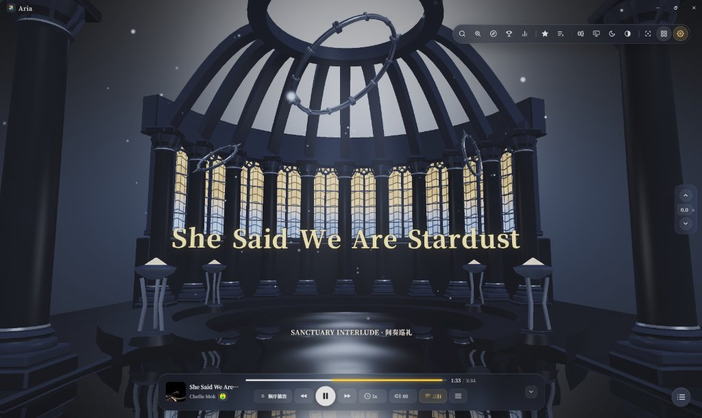<br><sub><b>琉璃龛 · Vitrail</b></sub></td>
    <td align="center" width="33%">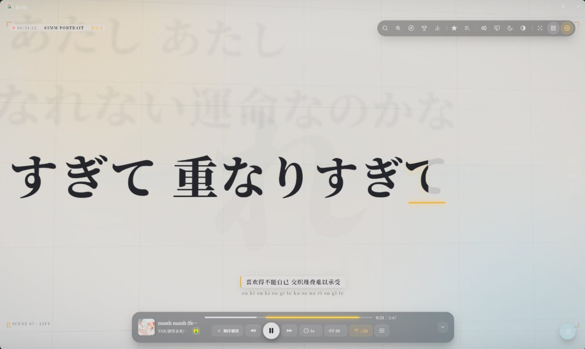<br><sub><b>镜幕 · FocalCut</b></sub></td>
    <td align="center" width="33%">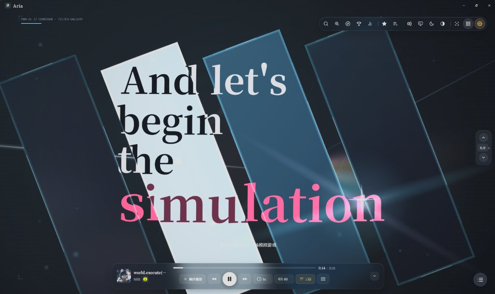<br><sub><b>棱镜 · Prism</b></sub></td>
  </tr>
  <tr>
    <td align="center">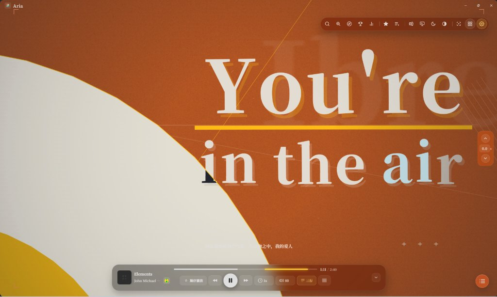<br><sub><b>画册 · Folio</b></sub></td>
    <td align="center">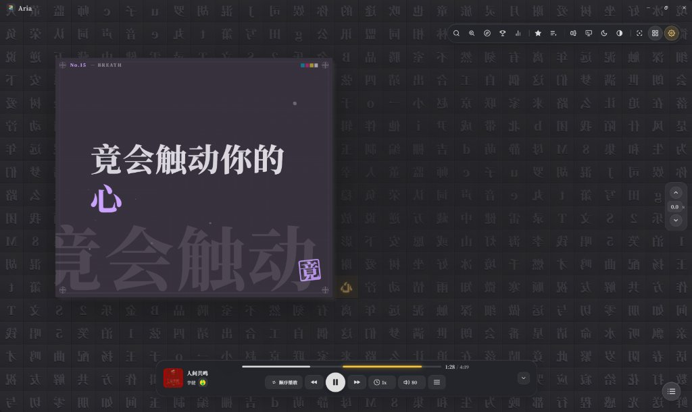<br><sub><b>活字 · Letterpress</b></sub></td>
    <td align="center">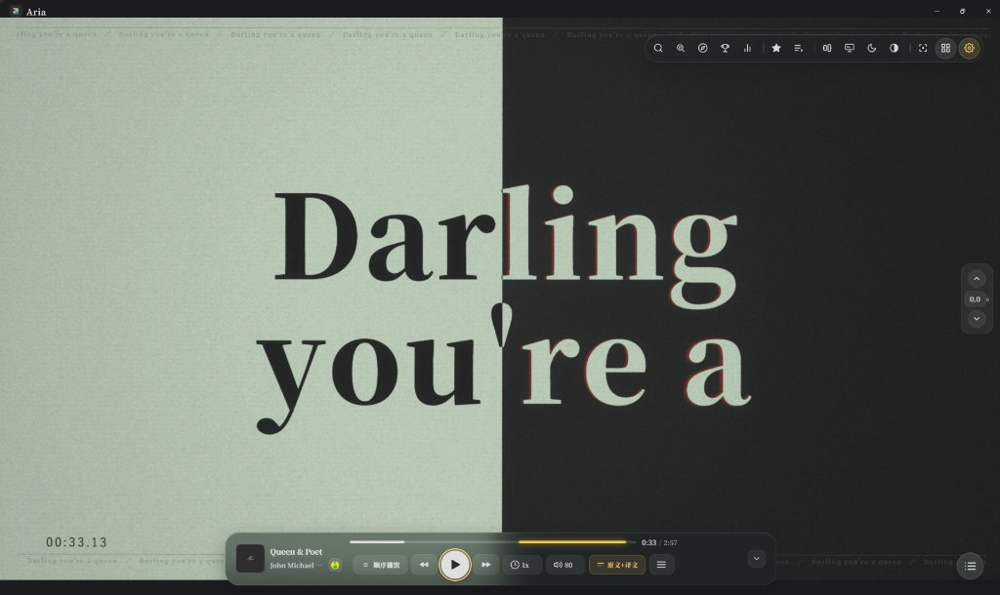<br><sub><b>字面 · Jizura</b></sub></td>
  </tr>
  <tr>
    <td align="center">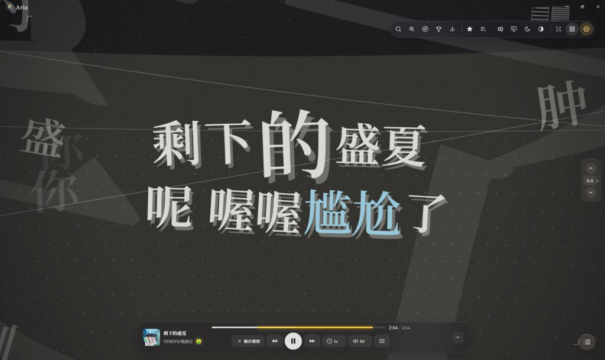<br><sub><b>版画 · Tempera</b></sub></td>
    <td align="center">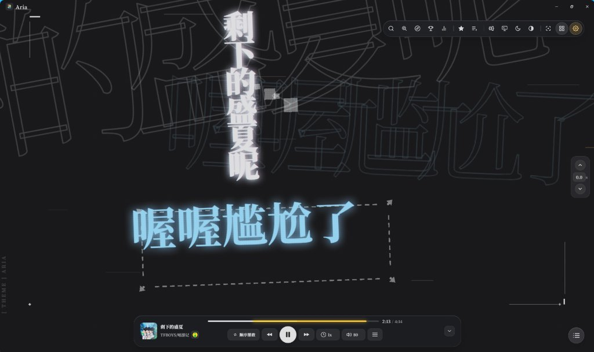<br><sub><b>诗镜 · Verse</b></sub></td>
    <td align="center">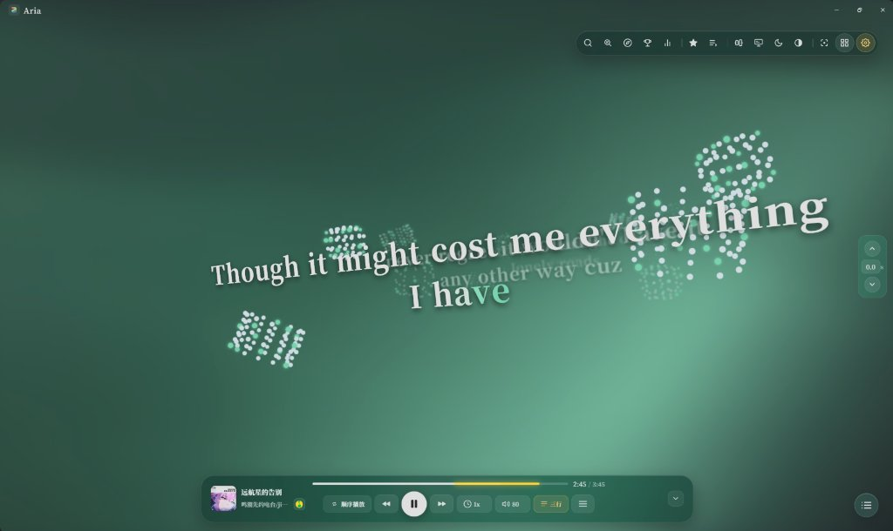<br><sub><b>穿行 · Dimension</b></sub></td>
  </tr>
  <tr>
    <td align="center">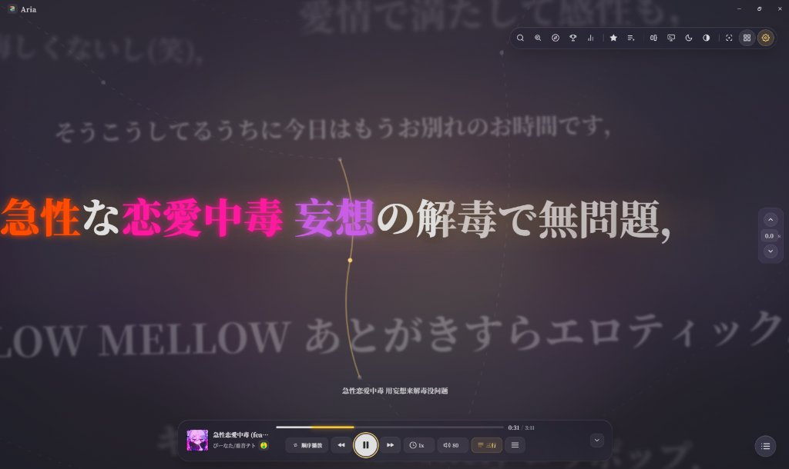<br><sub><b>云涌 · WordCloud</b></sub></td>
    <td align="center">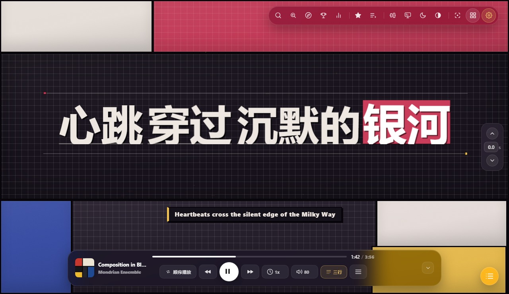<br><sub><b>格律 · Mondrian</b></sub></td>
    <td align="center">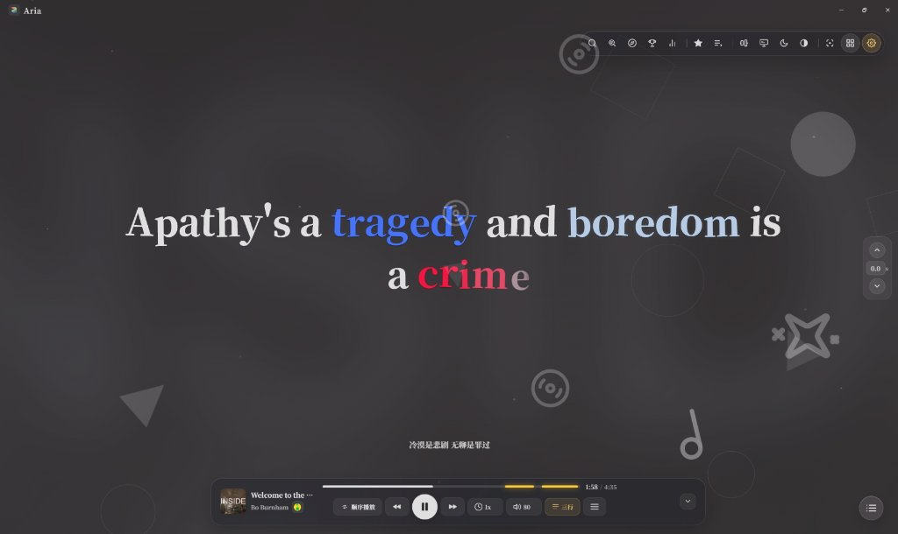<br><sub><b>飞白 · Fly-In</b></sub></td>
  </tr>
  <tr>
    <td align="center">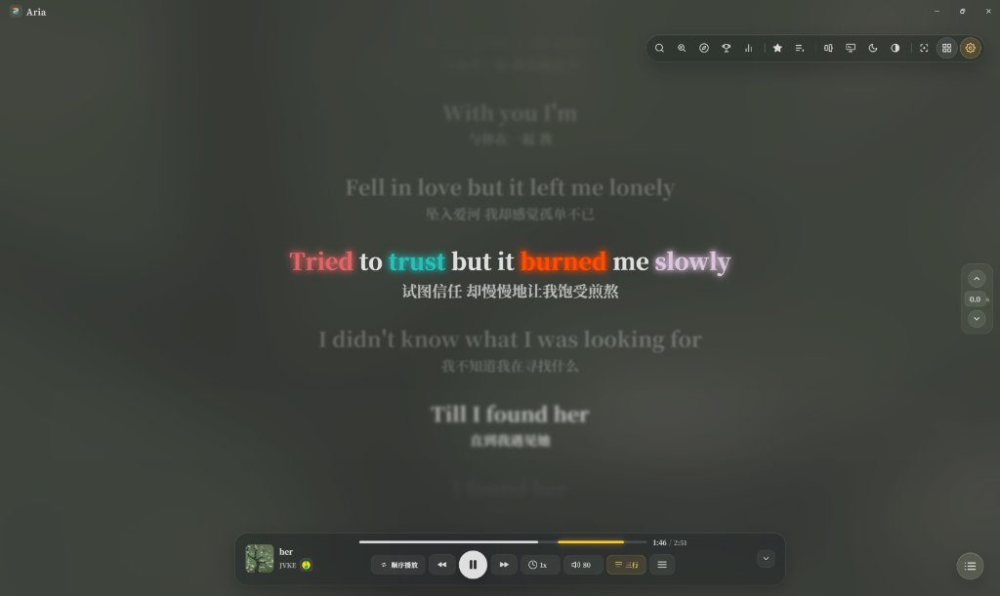<br><sub><b>拾光 · Lyrics</b></sub></td>
    <td align="center">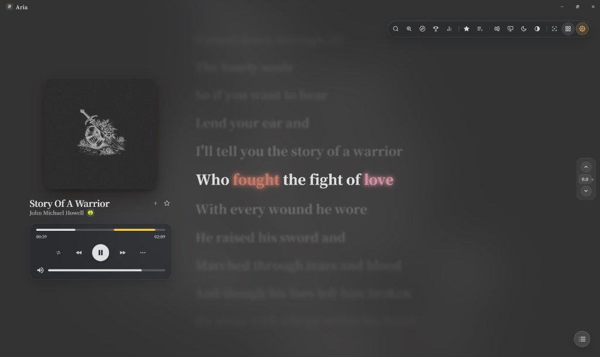<br><sub><b>默认模式 · Default</b></sub></td>
    <td align="center"></td>
  </tr>
</table>

开启 AI 情绪分析效果更好：逐句情感标注与高潮识别会驱动视觉模式的情绪配色与构图。未配置 AI 也能用，各模式都有纯时间轴的兜底表现。

阿拉伯语 / 希伯来语等 RTL 歌词在各视觉模式下自动从右往左点亮，无需手动设置。

## v3.0 更新亮点

- **四大全新旗舰视觉模式**：新增原生 WebGL2 3D 圣殿「琉璃龛 · Vitrail」、光学折射分镜「棱镜 · Prism」、瑞士天体海报「画册 · Folio」与重构后的 2.5D 建筑展墙摄影棚「镜幕 · FocalCut」；同步重绘「云涌 · WordCloud」星轨螺旋景深排版与全部 12 种模式封面预览卡。
- **视觉工坊 & 全局真毛玻璃体系**：设置面板重构为声明式「视觉工坊」（4 大家族 × 14 模式宫格浮层 + 三层参数收纳 + 实时预览）；剥离 Chromium 嵌套 Backdrop Root，顶栏、底栏、设置浮层与下拉菜单全链路实现通透高斯模糊，低性能 / 软件渲染自动降级。
- **后台恢复与帧率架构重构**：消除 60fps `:root` CSS 变量整页样式重算、全屏模式底层 150% 模糊空烧 GPU、`timeupdate` 异相双更新与桌面歌词同步刷盘卡顿；强化后台切回前台后的歌词索引、飞入字号与视觉器视口自愈（含活字字盘矩阵自适应缩放）。
- **听歌体验补强**：新增跟随当前视觉模式的歌词海报生成、年度 / 近期听歌报告、自建服务上游参数自定义（QQ / 酷狗 / 网易云）、专注模式顶栏无损收缩与完整双语（中 / 英）界面覆盖。

## 核心能力

| 模块 | 说明 |
|---|---|
| 逐字歌词 | YRC / KRC / QRC 全格式逐字时间轴，原词 / 翻译 / 罗马音三行布局；无逐字时自动对齐补全 |
| 多源搜索 | QQ 音乐 / 酷狗 / 网易云 / 酷我，本机自建服务第一优先、公网源池多梯队竞速兜底；自建服务支持高音质、每日推荐、云端歌单与接口参数自定义 |
| AI 情绪分析 | Gemini 或 OpenAI 兼容接口：逐句情感标注、高潮段落识别，驱动视觉模式换构图与配色 |
| 桌面歌词 | 独立透明窗口，自由拖动、点击穿透、BroadcastChannel 零阻塞同步与逐字本地插值 |
| 手机遥控器 | 同一局域网扫码或输入地址，用手机控制播放 / 切歌 / 音量（需 `--lan` 启动） |
| 本地音乐 | 本机扫描 + Enhanced LRC 逐字歌词生成 + 听歌识曲（Shazam / Vosk） |
| 歌单与数据 | 收藏 / 歌单 / 网易云 QQ 酷狗公开歌单导入 / 歌手主页 / 播放统计与听歌报告 |
| 音频处理 | 10 段均衡器（支持导入 AutoEQ PEQ）、空间音频 / 虚拟声场、WASAPI 原生输出、倍速（变速不变调）、长按 2× 快进、A-B 循环、无缝切歌淡入淡出、睡眠定时器 |
| 体验细节 | 跟随模式的歌词海报、歌词内搜索、双语排版切换、下一首预告、OSD 提示、专注模式、视觉配方导入导出、主题色板、动效强度滑杆、工具栏自定义 |

## 快速开始

### 绿色版（普通用户）

到 [Releases](../../releases) 下载 `Aria-Portable.zip`，解压到纯英文路径后：

- `Aria.exe` —— 桌面窗口版（推荐）
- `StartAria.bat` —— 浏览器网页版

不用装 Python / Node，依赖全部内置。

### 从源码运行

前置：Python 3.10+（后端只用标准库）、Node.js 20.19+ 或 22.13+（建议 22 LTS）、Git。桌面壳需 Rust 工具链。
Node 下限由两项依赖决定：QQ 音源镜像要求 `^20.17.0 || >=22.9.0`，仓库的 ESLint 10 要求 `^20.19.0 || ^22.13.0 || >=24`。

```bat
:: 1. 拉取音源服务到 _eval\（不入库，全新 clone 必须执行一次）
scripts\setup-vendors.bat

:: 2. 启动本地服务（默认只监听本机）
python server.py

:: 3a. 网页版：浏览器打开 http://localhost:8001
:: 3b. 桌面版：双击 restart-aria.bat（重启 + 增量 cargo build，首次会自动编译）
```

macOS / Linux 没有 bat，按脚本内容手动执行即可。

## 使用须知

1. **大陆用户若经 Cloudflare Worker 反代使用 AI，页面地址必须用 `http://localhost:8001`**：Worker 按页面来源（Origin）校验，`127.0.0.1` 会返回 `403 Forbidden`。直连 API（不经 Worker）不受此限制。
2. **默认只监听本机。** 想用手机访问（含手机遥控器）时执行 `python server.py --lan`。这会把搜索、代理和配置接口（含 AI Key）暴露给同网段设备，只在自己家的 WiFi 里用，用完关掉。
3. **自建音源服务需要单独登录。** 未登录时自动降级到免费源池：可搜索、可播放，但没有高音质、每日推荐与收藏歌单，登录与接口参数配置入口在「设置 → 自建服务」。

## 功能指南

### 桌面歌词

右上角「桌面歌词」按钮开启。拖动文字条移动位置，✕ 关闭，锁型按钮切换点击穿透。位置在拖动结束后自动保存。字号、颜色、描边、中英文字体在「设置 → 歌词」里调。

### 手机遥控器

`python server.py --lan` 启动后，手机浏览器访问 `http://<电脑局域网IP>:8001/remote.html`（启动时终端会打印可用地址）。可远程播放 / 暂停 / 切歌 / 调音量，歌词进度实时同步。

### 字体

- 全局字体在「设置 → 字体」里选；各视觉模式可在「设置 → 视觉模式」对应模式的「独立背景与字体覆写」里单独覆盖。
- **拖文件进字体文件夹即可**：把 `.ttf / .otf / .woff / .woff2` 放进 `web/src/font/`，刷新后自动出现在所有字体下拉里。
- 字体管理器按 衬线 / 黑体 / 楷体 / 像素 / 等宽 自动分类，支持分组折叠。
- 推荐字体（字库大、免费商用）：思源黑体（Noto Sans SC）、思源宋体、MiSans、HarmonyOS Sans、霞鹜文楷。
- **建议优先使用静态字重版本**：可变字体（VF，文件名常带 `-VF`）在全屏大字场景渲染开销较高，低端设备可能出现掉帧。

### 歌单与收藏

收藏：任意列表的行尾收藏按钮。歌单：左侧「歌单」页新建 / 重命名 / 删除，支持从网易云 / QQ / 酷狗的公开歌单链接导入，登录自建服务后可直接浏览各平台「我喜欢的歌」与云端歌单。

### AI 情绪分析

「设置 → AI 分析」里填 API 密钥（支持 Gemini 官方与 OpenAI 兼容接口）。大陆网络建议配 Cloudflare Worker 反代（`docs/cf-gemini-auth-worker.js` 有现成脚本），直连可填官方地址。密钥只存在本机 `user_config.json`，不上传第三方。

## 已知限制

- 多显示器 / 不同缩放率（DPR）组合未做完整测试，外接屏可能出现光标或定位偏移。
- WebGL2 3D 视觉模式（如琉璃龛）在无独显或纯软件渲染环境下会自动关闭毛玻璃与高耗后处理以保证流畅；可在「设置 → 性能」手动调整档位。
- 可变字体（VF）做全局字体时，全屏大字的插值渲染开销较高，低端设备建议用静态字重版本（如思源黑体 Bold），或把性能档调低。
- 内嵌歌词（USLT / 多轨 AWLRC）的主轨识别在个别文件上可能选错轨道。

## 关于开发方式

产品形态、架构决策与代码审校由作者完成，实现、测试与文档在 AI 协助下产出。提 issue 时正常描述问题即可，不必区分由谁编写。

## 常见问题

- **打开白屏 / 连不上**：确认 server 窗口没关、8001 端口没被占用；桌面版看 `server_debug.log`。
- **搜索没结果**：换一个音源试试；都失败大概率是第三方接口临时不可用，过会儿再试。
- **高音质选项是灰的**：需要对应平台自建服务登录。
- **AI 全部报 403**：页面地址不是 `localhost`，回到须知第 1 条。
- **桌面歌词重启后位置不对**：拖动结束后等一下再关；仍不生效就锁定→解锁一次。
- **手机遥控器连不上**：确认是用 `--lan` 启动的，且手机和电脑在同一 WiFi。

反馈问题请用 [ISSUE 模板](.github/ISSUE_TEMPLATE/bug_report.md)，附上 console 报错与系统信息能快很多。

## 架构简述

```
Tauri 2 壳（Rust）── 加载 http://localhost:8001，并拉起后端与原生音频引擎
        │
Python 后端（纯标准库 http.server，端口 8001）
  ├ 静态服务 web/ + /proxy + /api/*（含 /api/remote/* 手机遥控器总线）
  └ selfhost_service.py：三个 Node 音源服务（3100/3200/3201，仅绑回环）
```

前端为无框架分片模块（`web/src/app/*.js` 按编号加载），声明式设置与视觉工坊在 `web/src/config/` 与 `web/src/ui/`，视觉引擎在 `web/src/core/`（pvEngine / tunnelEngine / visualizers）。详细架构见 [AGENTS.md](AGENTS.md) 与 [CODE_WIKI.md](CODE_WIKI.md)。

## 第三方音源与免责声明

`_eval/` 目录下是第三方音源 API 项目的本地镜像（KuGouMusicApi / NeteaseCloudMusicApi / qq-music-api-node），由 `scripts/setup-vendors.bat` 克隆并安装，**不属于本仓库的一部分**，各自遵循其原始许可证，由原项目独立维护。本项目只在本机 127.0.0.1 上调用它们，不修改上游逻辑（`patches/` 为对 QQ 镜像的本地修复）。

在此基础上：

1. 本仓库不包含、不分发任何音频、歌词或封面内容。媒体内容要么来自你本机已有的文件，要么由上述第三方接口在运行时返回。
2. 第三方接口随时可能变更或失效，本项目不做任何可用性承诺。
3. 本项目是个人学习与自用目的的播放器前端，请自行确认所在地区对相关服务的使用条款与版权规定，优先支持正版。请勿将本项目或其打包产物用于商业分发。

## 致谢

- [folia-major](https://github.com/chthollyphile/folia-major)（AGPL-3.0）—— **"诗镜 · Verse" 与 "版画 · Tempera" 两个视觉引擎的代码来源**（逐行保真移植），完整清单见 [THIRD_PARTY_NOTICES.md](THIRD_PARTY_NOTICES.md)
- [JPV Lyrics Motion Kit](https://github.com/donbeeshyvt-jpg/jpv-lyrics-motion-kit)（AGPL-3.0）—— 隧道模式逐字入场主题、PV 背景形状场与 Cadenza 逐字光束扫描的来源（改作）
- [JIZURA](https://github.com/852wa/JIZURA)（MIT）—— 「字面 · Jizura」日系文字 PV 引擎灵感与架构来源
- [KuGouMusicApi](https://github.com/makbkf/KuGouMusicApi) / [NeteaseCloudMusicApi](https://github.com/Binaryify/NeteaseCloudMusicApi) / [qq-music-api-node](https://github.com/jsososo/QQMusicApi) —— 音源接口
- [Tauri](https://tauri.app/) · [segmentit](https://github.com/nekobato/segmentit) · [kuromoji.js](https://github.com/takuyaa/kuromoji.js)
- 字体：思源黑体 / 思源宋体（Noto CJK，SIL OFL）· 霞鹜系列 · 方舟像素 · Cubic 11

## 许可证

[AGPL-3.0](LICENSE)。本项目整体按 GNU Affero General Public License v3.0 发布。

**为什么是 AGPL**：「诗镜 · Verse」（`web/src/core/visualizers/sonnet/`）与「版画 · Tempera」（`web/src/core/visualizers/tempera/`）两个视觉引擎及若干工具模块（`pixiTextureBudget.js`、`utils/lyrics/*` 等）**逐行移植**自 [chthollyphile/folia-major](https://github.com/chthollyphile/folia-major)（**AGPL-3.0**）；隧道模式的部分逐字入场主题改作自 JPV Lyrics Motion Kit（AGPL-3.0）。AGPL 的传染性使整体作品须按 AGPL-3.0 发布。

- 第三方许可与**逐个文件的来源清单**：[THIRD_PARTY_NOTICES.md](THIRD_PARTY_NOTICES.md)
- 版权人自有部分（不源自上述项目的代码）同样可按 MIT 或其它条款单独授权；但**本仓库与其分发物是 AGPL-3.0 的组合作品**。
- `_eval/` 下的音源接口项目是运行时另行获取的独立项目，不在本仓库许可范围内。

## 相关文档

- [AGENTS.md](AGENTS.md) —— 运行时架构与硬性约束速查
- [CODE_WIKI.md](CODE_WIKI.md) —— 模块演进历史
- [docs/打包分发方案.md](docs/打包分发方案.md) —— 绿色版打包
- [docs/歌词模式视觉规范.md](docs/歌词模式视觉规范.md) —— 各歌词模式的排版与视觉规则
